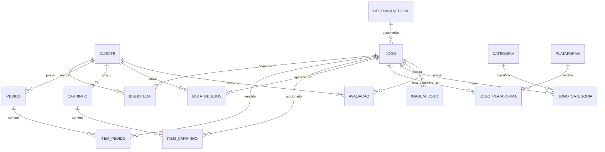

# Modelo de banco de dados — GameCore

Este modelo cobre as telas atuais do aplicativo: cadastro, jogos, categorias, imagens, carrinho, compras, biblioteca, lista de desejos e avaliações.

## Diagrama das relações

## Tabelas

### Cliente

| Campo | Tipo | Regra |
|---|---|---|
| `id` | inteiro | chave primária, gerado automaticamente |
| `nome` | texto | obrigatório |
| `usuario` | texto | obrigatório e único |
| `email` | texto | obrigatório e único |
| `senha` | texto | obrigatório; em produção deve ser armazenada como hash, nunca texto puro |
| `data_cadastro` | data/hora | obrigatório |

### Desenvolvedora

| Campo | Tipo | Regra |
|---|---|---|
| `id` | inteiro | chave primária |
| `nome` | texto | obrigatório e único |

### Jogo

| Campo | Tipo | Regra |
|---|---|---|
| `id` | inteiro | chave primária |
| `nome` | texto | obrigatório |
| `preco` | decimal | obrigatório, maior ou igual a zero |
| `descricao` | texto | obrigatório |
| `imagem_principal` | texto | caminho ou URL da capa |
| `data_lancamento` | data | obrigatório |
| `classificacao_indicativa` | texto | por exemplo: Livre, 12, 16 ou 18 |
| `desenvolvedora_id` | inteiro | chave estrangeira para `desenvolvedora` |
| `ativo` | booleano | permite ocultar um jogo sem apagar o histórico de compras |

### Categoria

| Campo | Tipo | Regra |
|---|---|---|
| `id` | inteiro | chave primária |
| `nome` | texto | obrigatório e único |

### JogoCategoria

Resolve a relação muitos-para-muitos: um jogo pode ter várias categorias e uma categoria pode conter vários jogos.

| Campo | Tipo | Regra |
|---|---|---|
| `jogo_id` | inteiro | chave estrangeira para `jogo` |
| `categoria_id` | inteiro | chave estrangeira para `categoria` |

Chave primária composta: `jogo_id + categoria_id`.

### Plataforma

| Campo | Tipo | Regra |
|---|---|---|
| `id` | inteiro | chave primária |
| `nome` | texto | obrigatório e único; exemplo: PC, PlayStation 5, Xbox Series X/S |

### JogoPlataforma

Resolve a relação muitos-para-muitos entre jogos e plataformas.

| Campo | Tipo | Regra |
|---|---|---|
| `jogo_id` | inteiro | chave estrangeira para `jogo` |
| `plataforma_id` | inteiro | chave estrangeira para `plataforma` |

Chave primária composta: `jogo_id + plataforma_id`.

### ImagemJogo

Substitui o campo único `imgExplJogo`, pois cada jogo pode ter várias imagens explicativas.

| Campo | Tipo | Regra |
|---|---|---|
| `id` | inteiro | chave primária |
| `jogo_id` | inteiro | chave estrangeira para `jogo` |
| `caminho_imagem` | texto | caminho ou URL da imagem |
| `ordem` | inteiro | define a sequência de exibição |

### Avaliacao

| Campo | Tipo | Regra |
|---|---|---|
| `id` | inteiro | chave primária |
| `cliente_id` | inteiro | chave estrangeira para `cliente` |
| `jogo_id` | inteiro | chave estrangeira para `jogo` |
| `texto_avaliacao` | texto | obrigatório |
| `nota` | inteiro | obrigatório, de 1 a 5 |
| `data_avaliacao` | data/hora | obrigatório |

Regra: `cliente_id + jogo_id` deve ser único. Assim, cada cliente cria apenas uma avaliação por jogo e pode editá-la depois.

### ListaDesejos

| Campo | Tipo | Regra |
|---|---|---|
| `id` | inteiro | chave primária |
| `cliente_id` | inteiro | chave estrangeira para `cliente` |
| `jogo_id` | inteiro | chave estrangeira para `jogo` |
| `data_adicao` | data/hora | obrigatório |

Regra: `cliente_id + jogo_id` deve ser único.

### Carrinho

| Campo | Tipo | Regra |
|---|---|---|
| `id` | inteiro | chave primária |
| `cliente_id` | inteiro | chave estrangeira para `cliente` |
| `criado_em` | data/hora | obrigatório |
| `ativo` | booleano | indica o carrinho atual do cliente |

### ItemCarrinho

| Campo | Tipo | Regra |
|---|---|---|
| `id` | inteiro | chave primária |
| `carrinho_id` | inteiro | chave estrangeira para `carrinho` |
| `jogo_id` | inteiro | chave estrangeira para `jogo` |

Regra: `carrinho_id + jogo_id` deve ser único.

### Pedido

Representa uma compra finalizada.

| Campo | Tipo | Regra |
|---|---|---|
| `id` | inteiro | chave primária |
| `cliente_id` | inteiro | chave estrangeira para `cliente` |
| `data_compra` | data/hora | obrigatório |
| `forma_pagamento` | texto | Cartão, PIX ou Boleto |
| `valor_total` | decimal | obrigatório |
| `status` | texto | PENDENTE, PAGO ou CANCELADO |

### ItemPedido

| Campo | Tipo | Regra |
|---|---|---|
| `id` | inteiro | chave primária |
| `pedido_id` | inteiro | chave estrangeira para `pedido` |
| `jogo_id` | inteiro | chave estrangeira para `jogo` |
| `preco_pago` | decimal | preço do jogo no instante da compra |

Regra: `pedido_id + jogo_id` deve ser único.

### Biblioteca

É a lista de jogos que o cliente pode jogar. Ela pode ser preenchida após um pedido com status `PAGO`.

| Campo | Tipo | Regra |
|---|---|---|
| `id` | inteiro | chave primária |
| `cliente_id` | inteiro | chave estrangeira para `cliente` |
| `jogo_id` | inteiro | chave estrangeira para `jogo` |
| `pedido_id` | inteiro | chave estrangeira para `pedido` |
| `adicionado_em` | data/hora | obrigatório |

Regra: `cliente_id + jogo_id` deve ser único.

## Regras do aplicativo

1. Um cliente só pode avaliar um jogo que esteja na própria biblioteca.
2. Um jogo comprado sai do carrinho e da lista de desejos.
3. Um jogo já comprado não pode entrar novamente na biblioteca, no carrinho ou na lista de desejos do mesmo cliente.
4. O preço em `item_pedido.preco_pago` não muda se o preço do jogo for alterado depois.
5. A exclusão de um jogo deve ser lógica (`ativo = false`), preservando pedidos, biblioteca e avaliações.

## Ordem recomendada para criar no Room

1. `Cliente`, `Desenvolvedora`, `Jogo`, `Categoria` e `Plataforma`.
2. `JogoCategoria`, `JogoPlataforma` e `ImagemJogo`.
3. `Avaliacao`, `ListaDesejos`, `Carrinho` e `ItemCarrinho`.
4. `Pedido`, `ItemPedido` e `Biblioteca`.

No início, você pode implementar só `Jogo`, `Categoria`, `Avaliacao`, `Cliente` e seus DAOs. Carrinho, pedido e biblioteca podem ser a próxima etapa.
